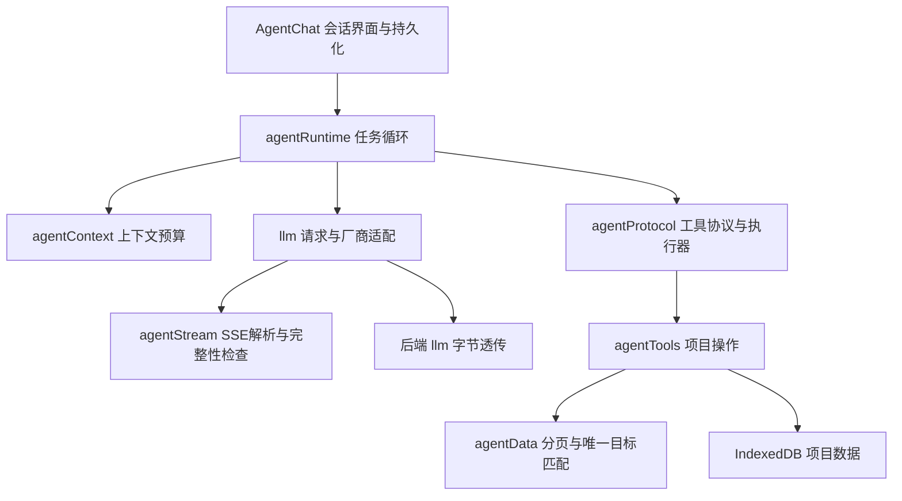

# Agent 架构与修复说明

## 模块边界



- `AgentChat.tsx`：收集用户输入、显示流式正文和执行记录，按助手消息 ID 保存结果。会话更新使用 IndexedDB 事务，避免覆盖同时更新的待办和授权。
- `agentRuntime.ts`：注入模型、工具执行器和快照生成函数，独立测试任务循环。每轮保留当前任务的工具参数、请求和结果；默认最多 12 轮，达到上限明确说明尚未完成。
- `agentContext.ts`：按可配置的模型上下文窗口预留输出和安全余量，优先保留当前任务，历史仅按完整用户回合移除；当前任务本身超预算则停止发送并提示。字符估算较保守，不作为计费依据。
- `agentStream.ts`：解析 SSE 事件、多行 data、UTF-8 分片和 EOF 尾包。错误事件、无完成信号的断流均报错，部分文本保留供核对。收到上游响应后不会因错误或空正文重新生成。
- `agentProtocol.ts`：工具目录、文本 JSON 兼容协议、权限、受限读取并发、取消检查和结构化执行记录。普通修改串行；删除和覆盖导入需确认，缺少确认器时拒绝执行。
- `agentData.ts`：文档字符分页与唯一目标匹配；模糊名称有多个候选时报错，不默选第一个。

## 已修复的行为

1. 第二轮不再删除工具参数说明、挂载资料；各轮结果完整进入本次对话。
2. 文档通过 `doc.read {doc, offset, limit}` 分页，默认 2500、最多 3000 字符；返回 `nextOffset`，避免被执行器的 4000 字符限制再次截断。表格自动按结果大小减少单页行数，单行过长时转字符分页。
3. 知识包约束保留完整；挂载的长文档会明确标记预览范围，并提供文档 ID 与分页读取方式。
4. `length`、疑似不完整格式、内容拦截、网络中断、用户取消、轮数上限分别处理。不完整响应整轮不执行工具，也不把正常 `stop` 结尾的逗号误报为额度耗尽。
5. 模型未正常完成当前响应时，不执行其中已闭合的部分工具块；错误后的自动重试不会重复请求整个生成。
6. 每个动作产生执行记录并保存；新增、复制、追加、导入等动作使用本次运行的成功记录防止完全相同参数的重复写入。普通赋值允许 A→B→A。用户以“继续 / 接着 / 续跑”开头继续最近未完成任务时，会沿用该运行的成功记录。
7. 取消会中止模型和联网请求、退出待确认状态，并阻止后续写入动作。已经开始的本地原子更新允许完成，不回滚此前成功操作。
8. 表格读取、搜索和统计不再写库或产生版本。
9. 非流式代理正确转发 `max_completion_tokens` 和取消信号；后端按原始字节透传 SSE，不重组事件边界。

## 验证

```powershell
cd frontend
npm run test:agent
npm run build
cd ../backend
python -m unittest test_agent_transport -v
```

运行时回归覆盖真实工具分页、断流与错误事件、不重复生成、六轮任务、取消确认、重复动作、唯一定位和读取并发；后端回归不需要真实模型密钥或启动服务。

## 当前边界

- 保留现有文本 JSON 工具协议与 OpenAI 兼容接口，没有强制厂商原生 function calling，避免改变已有模型接入方式。
- 续跑是用户主动继续，结合持久化记录与当前项目快照；并非浏览器关闭后的自动后台任务恢复。
- 去重依据工具名称和完全相同参数，不能识别不同名称、别名或不同措辞表达的同一业务操作。需要有意复制时使用工具的数量参数或明确的新参数。
- 长网页分页会重新抓取，最多读取后端抓取的 120000 字符；动态网页可能发生变化。长文档可以完整分页读取。
- 实际模型的额度、上下文容量和供应商中断仍可能限制任务；本次使用本地模拟回归验证，未调用用户真实模型进行付费测试。
